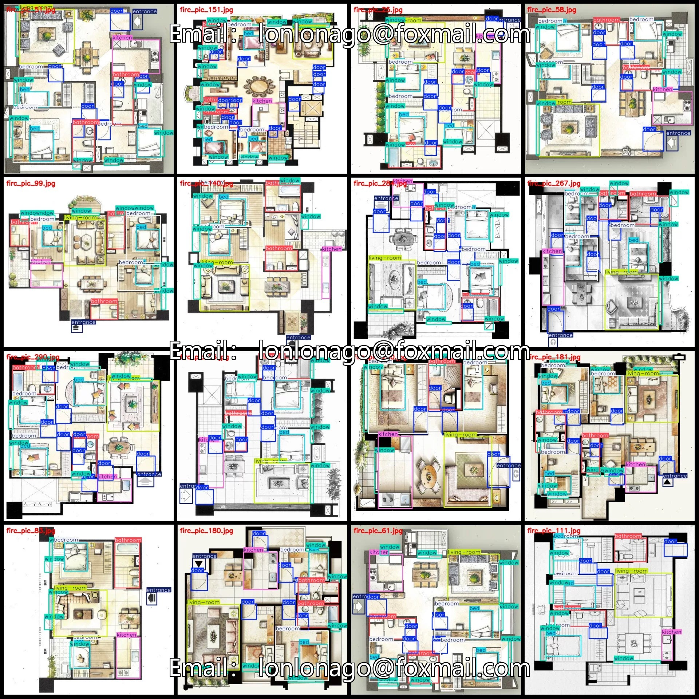
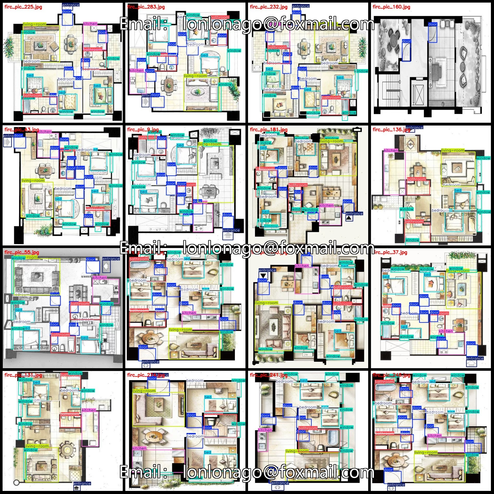
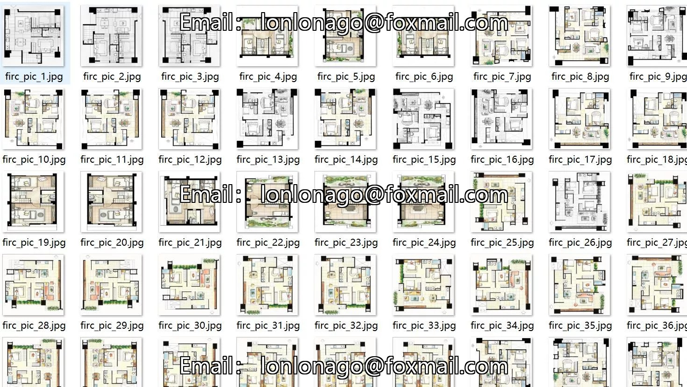
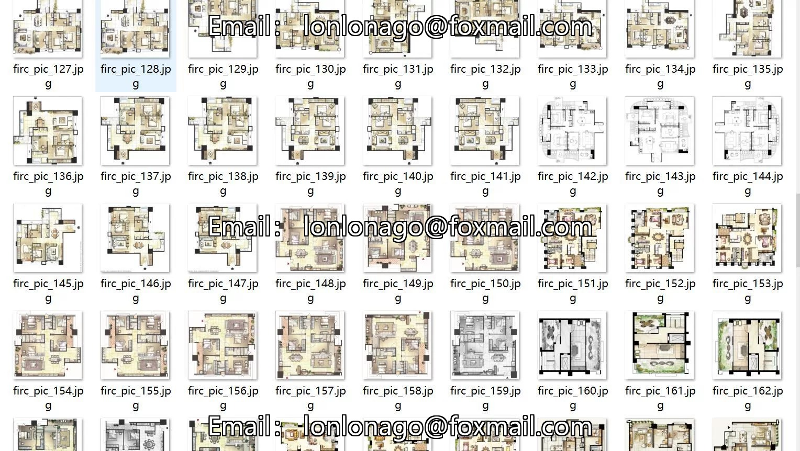
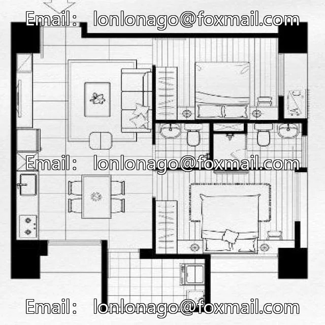
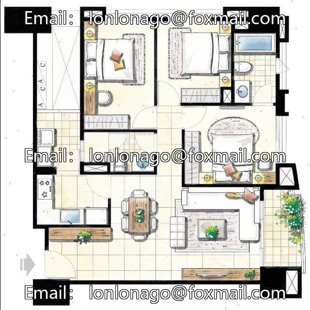
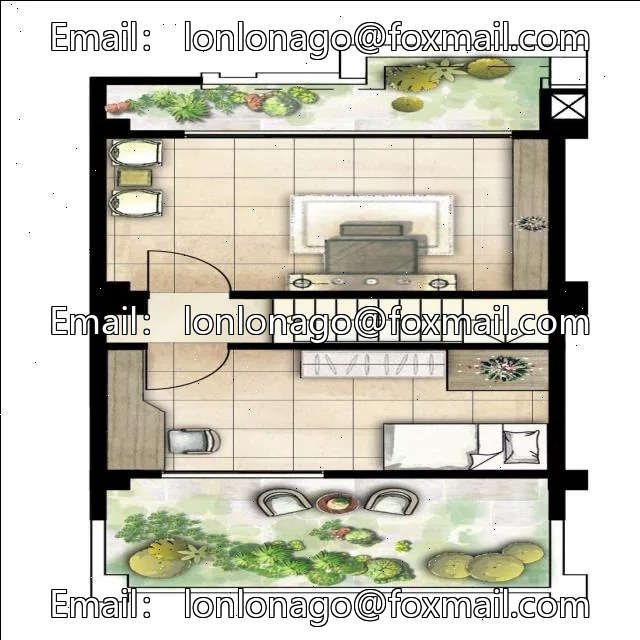

# Exterior wall, entrance bed window, kitchen, living room, bathroom, bedroom detection dataset VOC+Y

## Body

303 images in VOC+YOLO format, 8 categories with enhanced features for the dataset of interior design floor plans.
Warm reminder: Due to the dataset's replicability, please confirm compliance before purchasing.
Please note that there are 101 images in the dataset, with the remaining being enhanced images primarily formed by rotation and flipping. The enhancement is done at a ratio of 1:2.
Dataset format: Pascal VOC format + YOLO format (txt file without split path, only contains jpg images and corresponding VOC format xml files and yolo format txt files)
Number of images (number of jpg files): 303
Number of annotations (number of xml files): 303
Number of annotations (number of txt files): 303

Annotation Category Count: 8
Annotation Category Names (Note that the order of categories in the yolo format does not correspond to this, but is based on the classes.txt file in the labels folder): ["bathroom", "bed", "bedroom", "door", "entrance", "kitchen", "living-room", "window"]
Number of boxes per category and number of images occupied by each category
Bathroom (Bathroom) = 621 boxes, 294 images occupied
Bed (Bed) = 846 boxes, 294 images occupied
Bedroom (Bedroom) = 852 boxes, 294 images occupied

Door (frames) = 1968, image count = 237
Entrance (frames) = 240, image count = 240
Kitchen (frames) = 285, image count = 282
Living Room (frames) = 303, image count = 288
Window (frames) = 2046, image count = 300
Total frames: 7161
Image resolution: 640x640
Labeling tool used: labelImg
Labeling rules: Draw a rectangle around the category.
Important note: The dataset does not have separate training, validation, and test sets; you will need to manually split them.

Special : This dataset does not guarantee the accuracy of the trained models or weight files.

## Images

## Payment

Here is a pay link on Stripe ( https://buy.stripe.com/3cs8yP7sY87d0vu9AB ). Please contact me lonlonago@foxmail.com after funding $89, and I will send you a complete data files , thank you!

